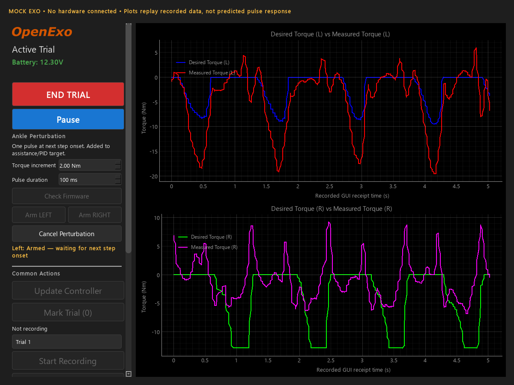

# One-shot ankle perturbations

## Researcher workflow

1. Use matching updated **Teensy control firmware and Nano BLE communications firmware**. The feature is not scheduled by the Python GUI or Bluetooth arrival times.
2. Perform the normal torque/FSR calibration and trial startup. Select **PJMC** (ankle controller 3) or **PJMC_PLUS** (11). Existing assistance parameters and PID settings remain in force. Other controllers reject perturbation requests; for perturbations without baseline assistance, use PJMC with zero baseline setpoints.
3. In **Active Trial → Ankle Perturbation**, click **Check Firmware**. This requests an acknowledgement from the control MCU, not just the BLE MCU. Unsupported firmware leaves the arm buttons disabled; normal GUI functions remain available. A successful check confirms protocol support, not that controller/calibration/motor interlocks currently permit arming.
4. Set **Torque increment** (signed Nm, −10 to +10, initially 0) and **Pulse duration** (10–200 ms, initially 100 ms). Zero torque cannot arm. These are software limits, **not validated human-safe settings**. The sign uses the existing controller's joint-torque convention: PJMC plantarflexion assistance is normally negative. Verify both sides and the configured motor/sensor direction on a fixture.
5. Click **Arm LEFT** or **Arm RIGHT**. Only one side can be pending at a time. The display distinguishes *sending* from firmware-confirmed *armed*. For this rig's one forefoot FSR per ankle, it waits for the **next ipsilateral forefoot-loading edge** (`toe_strike`), not heel strike, toe-off, a predicted gait percentage, or the next BLE packet. Arming while forefoot contact is already detected does not trigger immediately. The shared heel-or-toe ground-strike/gait detector is unchanged. After a threshold update, the pulse trigger requires a fresh unloaded sample before responding to loading. See [runtime threshold configuration](FSR_THRESHOLDS.md).
6. At that event, the firmware adds one rectangular torque-target pulse for the requested duration. It then removes the increment and disarms. The same request ID cannot fire again. Click an arm button again for a subsequent perturbation.
7. **Cancel Perturbation** cancels the pending/active pulse, without disabling baseline assistance. **Pause** disables motors using the existing control path and also cancels the pulse. End trial, calibration, controller/parameter/FSR changes and motor-disable commands also cancel it.

The pulse is a torque increment, not an absolute torque replacement. Its commanded angular impulse is amplitude × duration (Nm·s); neither actual delivered impulse nor physical ankle response is guaranteed. PJMC and PJMC_PLUS add the increment **before PID**, so feedback tracks the perturbed target instead of opposing an unexplained motor-output offset. PID gains/controller selections are not rewritten. Measured feedback, integral state, transmission dynamics and motor limits still apply; a rectangular target does not imply a rectangular measured torque or no PID settling after target removal.

No step within **10 seconds** causes expiry. A negotiated Nano session sends a 100 ms link heartbeat to the Teensy; a BLE disconnect cancels the perturbation and a heartbeat gap over **500 ms** cancels it even if the Nano stops communicating. This supervises the Nano/link, not proof that the researcher's GUI event loop is healthy. Timing follows the existing nominal 500 Hz loop; measure real loop timing/torque latency on the device.

While a request is pending, the GUI also polls a complete read-only firmware status value every 250 ms. This can recover an outcome even when a notification chunk is lost; it never retransmits an arm request. Repeated observations do not restart safety deadlines. If neither notifications nor readback resolve an acknowledgement/final status before its deadline, the GUI does **not** claim the device is disarmed or allow a second pulse. It sends cancel and reports unknown status. **Pause the exo before continuing**, then resolve the link/recheck firmware or reconnect. A late matching terminal status can resolve a pending operation. Request IDs do not wrap within a GUI session.

## Diagnosing an arm rejection or missing status

The October 14 lab log (`app_crash_20261014_174948.log`) contains explicit firmware rejections for requests 1 and 2. For request 3, the RX callback received only the trailing `20000n`, without the status prefix, so its outcome could not be reconstructed. The old reply did not include a rejection reason; the actual interlock responsible for those rejections remains unconfirmed.

The updated Teensy reports the reason, the Nano caches a complete status independently of notifications, and the GUI displays it (for example, unsupported controller, calibration still in progress, disabled motor, or a device error). A later detailed rejection readback can enrich a generic legacy notification. Late reads from an old connection are discarded. The GUI requests fresh Windows GATT discovery on connection so firmware-added characteristics are not hidden by the previous service cache. **No safety gate has been relaxed to make arming succeed.**

Use the repaired GUI and both repaired firmware builds together; restart the GUI and reconnect after updating firmware. Validate on an unloaded fixture first. If arming is rejected, record the specific reason before changing configuration.

## Compatibility

- **Old GUI + both new firmware builds:** no new handshake rows, controller parameters, telemetry fields or notifications appear unless the new `J` feature probe is explicitly received. Perturbation state starts inert; the normal control and telemetry protocol is retained.
- **New GUI + old firmware:** `J` is one otherwise-unknown command byte with **no binary payload**. No `j` arm payload is sent until capability is confirmed. This avoids feeding binary double bytes into a legacy command parser. Normal assistance/recording remains available.
- **Mixed firmware versions:** the Nano only enables `j` forwarding after a capability response from the Teensy. No Teensy acknowledgement means no feature activation.
- Runtime compatibility is covered by host/Qt tests; an old GUI connected to physical hardware has not been exercised here.

## Logging

The normal telemetry CSV shape is unchanged. During recording, firmware lifecycle events are appended to `<recording>.csv.perturbations.jsonl`, including request ID, side, state, magnitude, duration, an optional rejection reason, and a timestamp explicitly marked `gui_receipt`. The application log also records events outside recording. These timestamps are **not precise firmware onset timestamps**, and event delivery can be delayed/lost with BLE. Do not use them alone to claim millisecond-accurate physical perturbation timing.

## Run the GUI or hardware-free demo

From the repository root on Windows:

```text
.venv-perturbation\Scripts\python.exe Python_GUI\GUI.py
.venv-perturbation\Scripts\python.exe Python_GUI\mock_perturbation.py
```

The isolated `.venv-perturbation` contains the GUI requirements and pytest. To recreate it:

```text
uv venv --python 3.12 .venv-perturbation
uv pip install --python .venv-perturbation/Scripts/python.exe -r Python_GUI/GUI_requirements.txt pytest
```

The mock has no BLE adapter or motor connection. It uses recorded stance rising edges as its **surrogate** step detector and emits fragmented status frames through the real Qt parser. Its plots replay existing trial data, **not predictions of the new pulse response**. The saved recordings do not contain heel-contact streams sufficient to reconstruct all production `ground_strike` events. The production detector is tested separately with heel/toe sensor stubs.

Screenshot of the real Qt page with mock status and recorded data:



To capture another screenshot without a visible window:

```text
set QT_QPA_PLATFORM=offscreen
.venv-perturbation\Scripts\python.exe Python_GUI\mock_perturbation.py --screenshot Documentation\ankle-perturbation-gui.png
```

## Verification performed

- **82 tests passed; 12 subtests passed** (`python -m pytest tests -q`). Includes real Qt widgets/signals/MainWindow integration and existing ACK/recording/power/data-explorer regressions.
- Host C++ tests compile and execute the production state machine, wire codec, actual PJMC/PJMC_PLUS and PID function bodies, actual ground-strike detector, control-side UART handlers, Nano feature dispatch/link supervision/status routing, and BLE status sender. Hardware drivers/sensors/time are substituted. The wiring-order check verifies sensing → trigger → motor-command order.
- Tests cover left/right isolation, waiting for a new step, one-shot completion, signed magnitude, duration boundary and timer wrap, duplicate requests, unsafe-state rejection, explicit/legacy-command cancellation, no-step expiry, heartbeat loss/disconnect, unsupported firmware, malformed/fragmented status, and large request IDs. Additional regressions cover the observed missing-prefix bytes, complete readback and rejection reasons, stale-connection reads, fresh Windows service discovery, delayed diagnostic enrichment, malformed/versioned readbacks, and duplicate polling not resetting deadlines or clearing unknown-status lockout.
- Inactive PJMC outputs are bit-identical to the same controller without the overlay across **98,434 rows in all three local saved recordings**, using the dated SD-card PJMC parameter preset as a repeatable input test. Recorded measured torque is reused as input, not treated as a raw sensor trace or a model of human response. This does not establish the parameters used during those historical trials.
- Complete sketch builds succeeded for **`teensy:avr:teensy41`** (core 1.62.0) and **`arduino:mbed_nano:nano33ble`** (core 4.6.0), with repository `Libraries/`. The Teensy compiler emits warnings in existing code (including Board.h LED range and SPV2 extra qualifications); these were not changed for this feature. Nothing was uploaded/flashed.

Current firmware artifacts, full build/test logs and source/artifact SHA-256 hashes are retained in **`build/fsr-thresholds/`** (`verification.json`). The earlier `build/ankle-perturbation-status-fix/` and `build/ankle-perturbation/` directories predate the threshold editor and explicit forefoot trigger; do not confuse them with the current binaries. They are **not** a recommendation to flash without checking the actual lab hardware and the validation requirements below.

Re-run host/Qt tests (g++ or clang++ must be available):

```text
.venv-perturbation\Scripts\python.exe -m pytest tests -q
```

Build source for the correct boards with Arduino CLI, setting `--libraries Libraries` and explicit `--build-path`/`--output-dir` outside the source tree. The checked targets above are not evidence that a different board revision will work. No new Python dependencies beyond the GUI requirements and pytest are required.

## Protocol / implementation

- GUI→Nano `J`: capability/session query, zero payload. Nano→Teensy UART `0x1C`. Authoritative response comes back as UART `0x1D`, then BLE `Sp5c0n0n0n0n0n`.
- GUI→Nano `j`: four little-endian doubles `[side, signed_Nm, duration_ms, request_id]`. Side 1=left, 2=right. `[0, 0, 1, id]` cancels. IDs are integer 1…9999. Both MCUs validate before narrowing/casting fields.
- Nano→Teensy request `0x1E`: request ID high byte in `joint_id`, payload `[id_low, side, magnitude, duration]`. Link supervision uses `0x20`, one boolean field.
- Teensy→Nano status `0x1D`: ID high byte in `joint_id`, payload `[id_low, side, state, magnitude_low, magnitude_high, duration, reason]`. Updated Nano firmware also accepts the original six-field status, without a specific reason. Magnitude bytes encode `round(Nm×100)+1000`. All fixed-point UART fields are integers ≤255, preventing the existing signed-16-bit ×100 encoding from overflowing IDs or losing hundredths of Nm.
- Nano→GUI: `Sp5c<id×100>n<side×100>n<state×100>n<Nm×100>n<duration×100>n`, sent in complete ≤20-byte chunks and parsed independently of live torque telemetry. States: 0 capability, 1 armed, 2 active, 3 completed, 4 cancelled, 5 rejected, 6 expired.
- Read-only GATT status UUID `6e400004-b5a3-f393-e0a9-e50e24dcca9e`: 12 bytes, little-endian `<2sBHBBBhH>` = magic `AP`, version 1, request ID, side, state, reason, signed centi-Nm, duration ms. It is the latest outcome received from the Teensy, not a physical torque measurement or a continuous proof of link health. The existing notification format is unchanged.
- `AnklePerturbation.h`: bounded single-shot engine; `AnklePerturbationSupport.h`: permissions/joint routing; `AnklePerturbationProtocol.h` and `AnklePerturbationUart.h`: additive transport. `Side.cpp` schedules locally after sensor sampling; `Exo.cpp` supervises safety even if a side/controller is not running.

## Required before participant use

**This is software-tested, not hardware-validated or a safety-certified study intervention.** Verify board configuration, sensor calibration/thresholds, polarity on both ankles, actual torque and impulse, combined assistance+PID saturation, no-step expiry, cancellation, BLE interruption and stop behavior on an unloaded fixture first. Then follow your lab's approved validation/study procedures before anyone wears the device. The existing `Exo.cpp` explicitly disables the physical e-stop input by assigning `data->estop = 0`; this feature does not alter or remedy that existing configuration. Do not assume an effective hardware emergency stop without independently verifying it.
