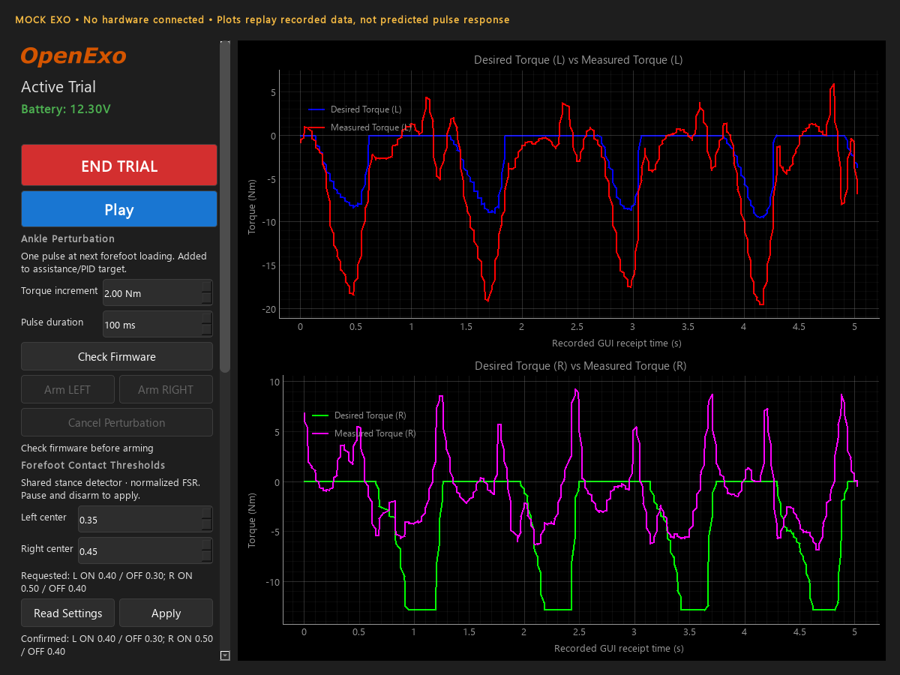

# Runtime forefoot contact thresholds

The perturbation checkpoint is commit `6ae357a`. This extension adds an optional,
confirmed settings protocol and a researcher-facing editor; it does not change the
legacy GUI startup, telemetry schema, controller parameter layout, or `R` command.

## Researcher workflow

1. Use the updated GUI and matching updated Nano and Teensy firmware.
2. In Active Trial, **Pause** the exo and make sure no perturbation is pending.
   The GUI requests actual settings from the Teensy after Pause. Use **Read Settings**
   again if a pending pulse or calibration prevented that read from being usable.
3. Under **Forefoot Contact Thresholds**, edit separate left/right center values.
   The preview explicitly says **Requested**, showing contact ON and contact OFF.
4. Click **Apply**. No values are sent while merely editing the fields.
5. Wait for **Confirmed** with the actual ON/OFF values returned by the Teensy.
   Resume and perturbation arming are blocked during the transaction. If an apply
   times out, remain paused and use Read Settings to resolve what the firmware
   actually holds. The GUI does not retry a write automatically.
6. After a threshold change, the pulse trigger must observe the selected forefoot
   unloaded before it can respond to a subsequent loading edge. A threshold edit
   must not itself be interpreted as a new physical step.

Centers have two-decimal precision and software bounds **0.06–0.94**, with a fixed
hysteresis half-width of **0.05**. A center of 0.25 means ON 0.30 / OFF 0.20. These
are processed, calibration-normalized FSR units, not force or body-weight fractions.
The bounds keep both thresholds inside the nominal normalized range; they are not
validated study settings. Calibration/refinement and fixture validation remain necessary.

The settings affect the **shared forefoot stance detector**, not only perturbations.
The perturbation trigger now explicitly uses the forefoot rising edge (`toe_strike`)
for this rig's one forefoot FSR per ankle. The existing heel-or-toe `ground_strike`
and other gait logic are left unchanged. Initial heel contact is not observable from
an unloaded forefoot sensor; do not label this event heel strike.

Confirmed values become the GUI session's presets for later trial starts. They are
not persisted to disk; a new GUI process starts with the existing 0.25 defaults.
During recording, confirmed read/apply/rejection replies are written next to the
CSV in `<recording>.csv.fsr_thresholds.jsonl`, with GUI-receipt timestamps. Outside
recording they are in the application log. The telemetry CSV is unchanged.

## Confirmation and compatibility

- `K`: zero-payload capability probe; unknown legacy firmware does not receive binary payloads.
- Only after control-MCU support is acknowledged does the Nano forward `k` requests.
- `k`: four little-endian doubles `[operation, left_center, right_center, request_id]`.
  Operation 0 reads settings (both values zero); operation 1 applies both settings.
- UART: capability `0x21`, request `0x22`, reply `0x23`. IDs are split across bounded
  fields to avoid the existing fixed-point transport overflowing large IDs.
- Read-only GATT UUID `6e400005-b5a3-f393-e0a9-e50e24dcca9e` contains a complete
  16-byte `<2sBHBBhhhhB>` snapshot: magic `FT`, version 1, request ID, state, reason,
  left lower/upper and right lower/upper in centi-units, and an editable flag.
- States: 0 capability, 1 read, 2 applied, 3 rejected. Reasons: 1 pause/motors,
  2 pending perturbation, 3 invalid settings, 4 calibration in progress.
- Apply is checked again on the Teensy: user paused, all used motors disabled,
  no pending/active pulse, no relevant calibration, and valid values. It is not
  authorized merely because a GUI button was enabled.
- Capability alone is not a settings read. Actual reads/applies use correlated IDs;
  the GUI polls uncached status, ignores stale IDs/connections, and checks all four
  effective thresholds before calling an apply confirmed.
- The optional editor remains disabled on older firmware. A failed read-only probe
  does not block ordinary assistance. An ambiguous apply does block resuming until
  actual settings are read. No new notifications are added to the legacy stream.

## Verification and mock

Tests cover actual Qt widgets and MainWindow routing, request payloads, firmware
pause/motor/pulse/calibration checks, numeric bounds, actual-value readback, stale
connections/IDs, timeout behavior without write retries, large IDs, separate BLE
status storage, forefoot-only triggering despite a heel-channel state, and the
fresh-unload requirement. Software tests do not validate physical timing or torque.

Run tests with `.venv-perturbation/Scripts/python.exe -m pytest tests -q`.
Native build logs/artifacts are in `build/fsr-thresholds/`; consult their verification
manifest for the tested source and binaries, not the older perturbation-only builds.
Nothing is flashed automatically.

The hardware-free mock also implements the settings transaction and pause interlock.
It continues replaying the original recorded traces; changing mock settings does
not simulate a new sensor trace or physical perturbation response.

Capture the actual Qt editor without connecting hardware:

```text
set QT_QPA_PLATFORM=offscreen
.venv-perturbation\Scripts\python.exe Python_GUI\mock_perturbation.py --screenshot Documentation\fsr-threshold-editor.png --settings-screenshot
```



Before participant use, validate forefoot event timing, sensor thresholds, polarity,
combined assistance/PID behavior and effective stop behavior on an unloaded fixture.
The existing disabled physical e-stop input is not changed by this feature.
